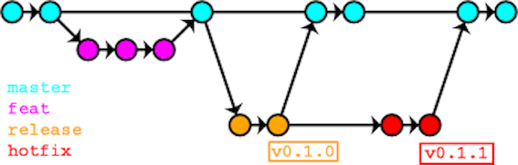

# 分支、Commit 与代码提交规范

Balco 使用 GitHub 进行研发协作。改动应能从需求或缺陷追溯到分支、Commit、Pull Request（PR）和发布版本。仓库权限与结构见[代码仓库规范](/zh/dev/01-source-code-repositories)。分支名参考 [Conventional Branch](https://conventionalbranch.org/) 的 `<type>/<description>` 格式。

## 分支规范

| 分支 | 用途 | 合并方向 | 示例 |
| --- | --- | --- | --- |
| `main` | 受保护的集成分支和发布制品的源码来源 | 接受普通工作分支及 `release` 的已评审 PR | `main` |
| `dev` | 开发者个人分支 |  | `dev/su` |
| `feature` | 新功能 | 从 `main` 创建，向 `main` 提 PR | `feat/report-export` |
| `hotfix` | 发布版本的紧急修复 | 从目标 `release` 创建，向该发布分支提 PR | `hotfix/security-patch` |
| `release` | 发布准备与稳定化 | 从 `main` 创建，发布修改评审后向 `main` 提 PR | `release/v0.1` `release/v1.0.2` |

  

日常分支流向：

- **main → dev**
- **main → feat → main**

发布修复流向：

- **release → hotfix → release → main**

## Commit 规范

一个 Commit 只处理一个明确目的。提交信息使用 `type: #{Ticket_No} short description`，模块或组件名称可作为可选范围。按改动的主要目的选择类型：

| 类型 | 适用改动 | 示例 |
| --- | --- | --- |
| `feat` | 新增功能 | `feat: add export feature` `feat: #123 add export feature` `feat: add export feature (#123)` |
| `fix` | 修复缺陷 | `fix: resolve sign-in failure` |
| `docs` | 只修改文档 | `docs: expand authentication guidance` |
| `refactor` | 重构代码结构 | `refactor: split order service` |
| `test` | 新增或调整测试代码 | `test: cover export flow` |
| `perf` | 改善性能 | `perf: reduce duplicate queries` |
| `ci` | 调整持续集成或部署流水线 | `ci: add test step` |

如果改动对应 GitHub Issue，在提交信息末尾或正文写出 Issue 编号，例如 `feat: add export feature (#123)`；涉及多个 Issue 时在正文逐一列出。没有 Issue 时不必虚构编号。描述应说明实际变化，避免只写“update”或“WIP”。

## 提交与评审规范

1. 开发者在工作分支完成代码、测试和相关文档，本地运行项目要求的检查，再推送并创建指向 `main` 的 PR。
2. 提交前检查改动范围，不把密码、令牌、证书私钥、生产数据或包含内部信息的构建结果写入 Git 历史。
3. 作者自检并等待必需检查通过；至少一名非作者评审。
4. 使用 GitHub Ruleset 保护 `main` 和 `release`：限制直接推送，要求 PR 评审、必需状态检查和对话解决。
