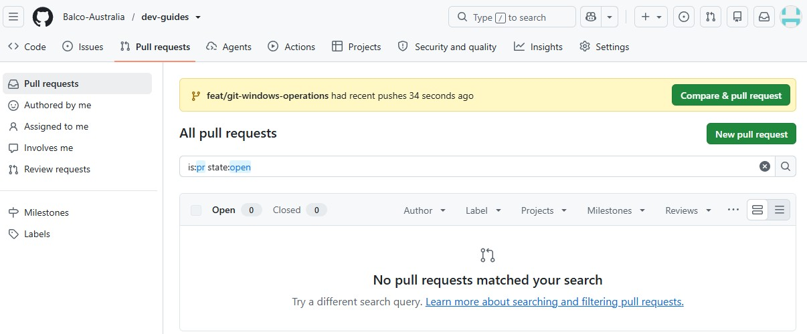
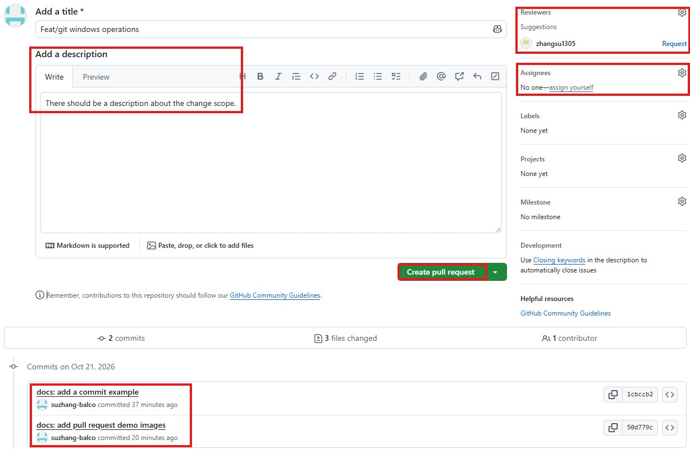

# Quickstart

本文说明一次常规改动如何从 `main` 分支进入经过评审的 Pull Request（PR）。开始前，按[代码仓库](/zh/dev/01-source-code-repositories)和[开发工具](/zh/dev/03-developer-tools)文档开通仓库权限。

## 环境准备

在本机命令行安装 Git：

**Windows**：在 PowerShell 或命令提示符中执行（[Git for Windows 安装说明](https://git-scm.com/install/windows)）：

```powershell
winget install --id Git.Git -e --source winget
```

**macOS**：在终端执行。已安装 Homebrew 时使用 `brew`；否则安装包含 Git 的 Apple Command Line Tools（[Git for macOS 安装说明](https://git-scm.com/install/mac)）：

```bash
brew install git
```

安装完成后打开新终端，检查 Git 版本，并设置 Commit 显示的姓名和邮箱。希望 GitHub 将 Commit 关联到本人账号时，使用与 GitHub 账号关联的邮箱。

```bash
git --version
git config --global user.name "Your Name"
git config --global user.email "you@example.com"
```

## 1. 克隆仓库并创建工作分支

新建工作分支时，从 GitHub 复制仓库地址，替换下面的示例地址，然后执行：

```bash
git clone https://github.com/Balco-Australia/demo-repository.git
cd demo-repository
git switch -c feat/demo
```

若远端已存在 `feat/demo`，或已在 GitHub 手动创建该分支，也可直接克隆该分支：

```bash
git clone -b feat/demo https://github.com/Balco-Australia/demo-repository.git
cd demo-repository
```

## 2. 修改并检查

修改文件，运行该仓库要求的本地检查，提交前核对暂存内容：

```bash
git status
git add .
git commit -m "feat: describe the change"
```

按改动类型选用[Commit 类型](./09-git-workflow.md#commit-规范)，例如 `feat` 或 `fix`。`git add .` 后仔细检查 `git diff --cached`，避免提交凭据、生产数据或生成的构建结果。

## 3. 推送分支

新建的本地分支尚未关联同名远端分支时，首次推送使用 `-u`（`--set-upstream`）。该命令创建或更新 `origin/feat/demo`，并将其设为本地分支的上游分支：

```bash
git push -u origin feat/demo
```

当前分支已跟踪同名远端分支后，后续提交可直接执行：

```bash
git push
```

## 4. 创建指向 `main` 的 PR

在 GitHub 创建 PR，**base 选 `main`**，compare 选工作分支。



描述改动、检查与测试结果，以及部署情况。等待必需检查通过和至少一名非作者评审；合并后删除工作分支。


